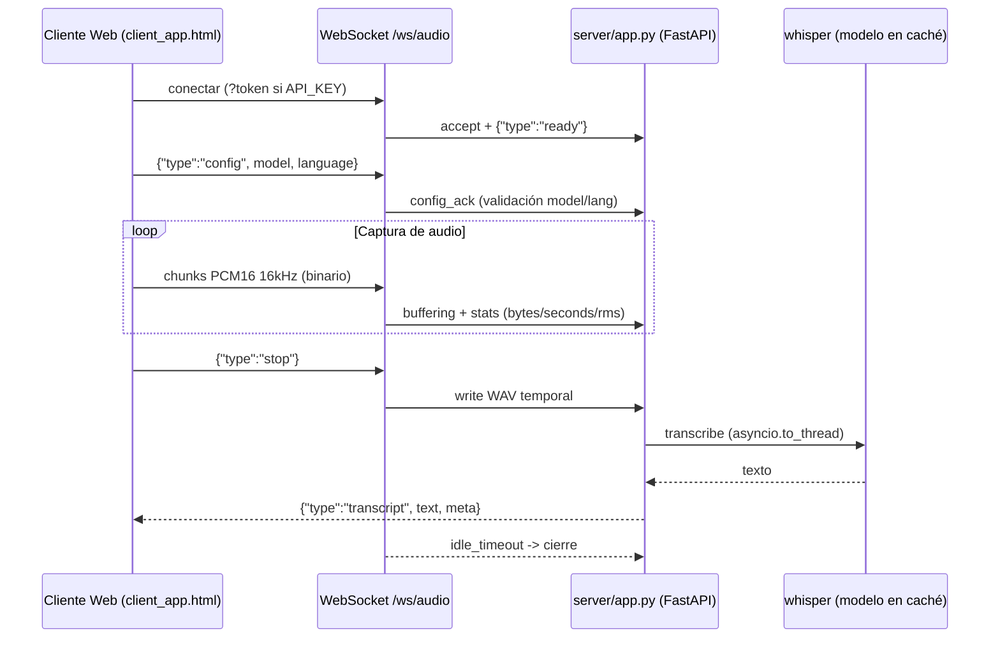

# voice-web

Servicio web que recibe audio por WebSocket, lo transcribe usando OpenAI Whisper (librería nativa) y envía el texto resultante. Modelo pre-cargado al iniciar para baja latencia.

[](LICENSE)
[](https://python.org)
[](https://github.com/bi0punk/voice-web/actions/workflows/ci.yml)

## Contenido

- [Características](#características)
- [Arquitectura](#arquitectura)
- [Stack](#stack)
- [Estructura del repositorio](#estructura-del-repositorio)
- [Instalación](#instalación)
- [Uso](#uso)
- [Configuración](#configuración)
- [Tests / CI](#tests--ci)
- [Roadmap](#roadmap)
- [Licencia](#licencia)

## Características

- Transcripción de voz en tiempo real vía WebSocket
- Whisper cargado como librería nativa (no CLI) — modelo pre-cargado, latencia reducida
- Soporta múltiples modelos: `tiny`, `base`, `small`, `medium`, `large`, `large-v2`, `large-v3`
- Configuración de idioma (Español, Inglés, Francés, Alemán, etc.)
- Cliente HTML/JS con captura de micrófono, downsampling a 16kHz PCM16
- Detección de silencio y buffer por emisión (máx. 30s por frase)
- Telemetría en vivo: nivel RMS, bytes bufferizados, latencia de transcripción
- Timeout de inactividad configurable
- Autenticación opcional por token en WebSocket

## Arquitectura



## Stack

- **Python 3.11+**
- **FastAPI** — servidor WebSocket asíncrono
- **OpenAI Whisper** — librería nativa de speech-to-text
- **PyTorch** — backend de Whisper
- **uvicorn** — servidor ASGI
- **numpy** — procesamiento de audio
- Linting: Ruff | Tests: pytest

## Estructura del repositorio

```
voice-web/
├── server/
│   └── app.py              # FastAPI WebSocket server con Whisper STT nativo
├── client/
│   └── client_app.html      # Cliente web de captura de audio
├── tests/
│   └── test_smoke.py       # Tests de humo
├── pyproject.toml           # Configuración del proyecto
├── requirements.txt         # fastapi, openai-whisper, numpy, etc.
├── .env.example             # Variables de entorno
├── .github/
│   └── workflows/
│       └── ci.yml           # CI: Ruff + pytest
├── LICENSE
└── README.md
```

## Instalación

```bash
git clone https://github.com/bi0punk/voice-web.git
cd voice-web
pip install -r requirements.txt
```

Requisitos: Python >= 3.11, GPU NVIDIA recomendada (CUDA) para Whisper (aunque funciona en CPU) y un navegador moderno con soporte MediaDevices API para el cliente web.

## Uso

### Iniciar servidor

```bash
python -m server.app
```

El servidor se inicia en `http://0.0.0.0:8000` y expone el WebSocket en `ws://<IP>:8000/ws/audio`.

### Con autenticación

Si configuraste `VOICE_API_KEY`, conecta el WebSocket con el parámetro `token`:

```
ws://<IP>:8000/ws/audio?token=tu_api_key
```

### Cliente web

Abre `client/client_app.html` en un navegador:

1. Cambia la URL del WebSocket a `ws://IP_SERVIDOR:8000/ws/audio?token=...`
2. Haz clic en **Connect**
3. Selecciona modelo (`tiny`, `base`, etc.) e idioma
4. Haz clic en **Start** para comenzar a grabar
5. Habla — el audio se envía en chunks PCM16 a 16kHz
6. Haz clic en **Stop** para transcribir el buffer acumulado

### Protocolo WebSocket

**Cliente → Servidor:**
- Audio binario: PCM16 mono 16kHz
- `{"type": "config", "model": "base", "language": "Spanish"}`
- `{"type": "stop"}` — finalizar emisión y transcribir

**Servidor → Cliente:**
- `{"type": "ready", "sr": 16000, ...}`
- `{"type": "config_ack", "model": "...", "language": "..."}`
- `{"type": "stats", "bytes": ..., "seconds": ..., "rms": ...}`
- `{"type": "transcript", "text": "...", "meta": {"latency_sec": ..., "model": "..."}}`

## Configuración

Variables de entorno (ver `.env.example`):

| Variable | Default | Descripción |
|---|---|---|
| `VOICE_HOST` | `0.0.0.0` | Host de escucha |
| `VOICE_PORT` | `8000` | Puerto |
| `VOICE_API_KEY` | (vacío) | Token de autenticación WebSocket. Si se deja vacío, se deshabilita la auth |
| `VOICE_DEFAULT_MODEL` | `base` | Modelo Whisper por defecto |
| `VOICE_DEFAULT_LANG` | `Spanish` | Idioma por defecto |
| `VOICE_SAMPLE_RATE` | `16000` | Frecuencia de muestreo |
| `VOICE_MAX_UTTERANCE_SEC` | `30` | Máximo segundos por emisión |
| `VOICE_IDLE_TIMEOUT` | `60` | Timeout de inactividad (segundos) |

Modelos permitidos: `tiny`, `base`, `small`, `medium`, `large`, `large-v2`, `large-v3`

Idiomas permitidos: `Spanish`, `English`, `French`, `German`, `Italian`, `Portuguese`, `Japanese`, `Chinese`, `Russian`, `Arabic`

## Tests / CI

```bash
pip install pytest
python -m pytest tests/ -v
```

GitHub Actions ejecuta Ruff linting y pytest en cada push y pull request.

## Roadmap

- [x] Transcripción por WebSocket con Whisper nativo
- [x] Cliente web con captura de micrófono y downsampling
- [ ] Envío del texto transcrito a una máquina remota
- [ ] Reconexión automática del cliente
- [ ] Autenticación JWT
- [ ] Streaming continuo sin stop
- [ ] Cola de transcripción
- [ ] VAD (Voice Activity Detection)

## Licencia

MIT